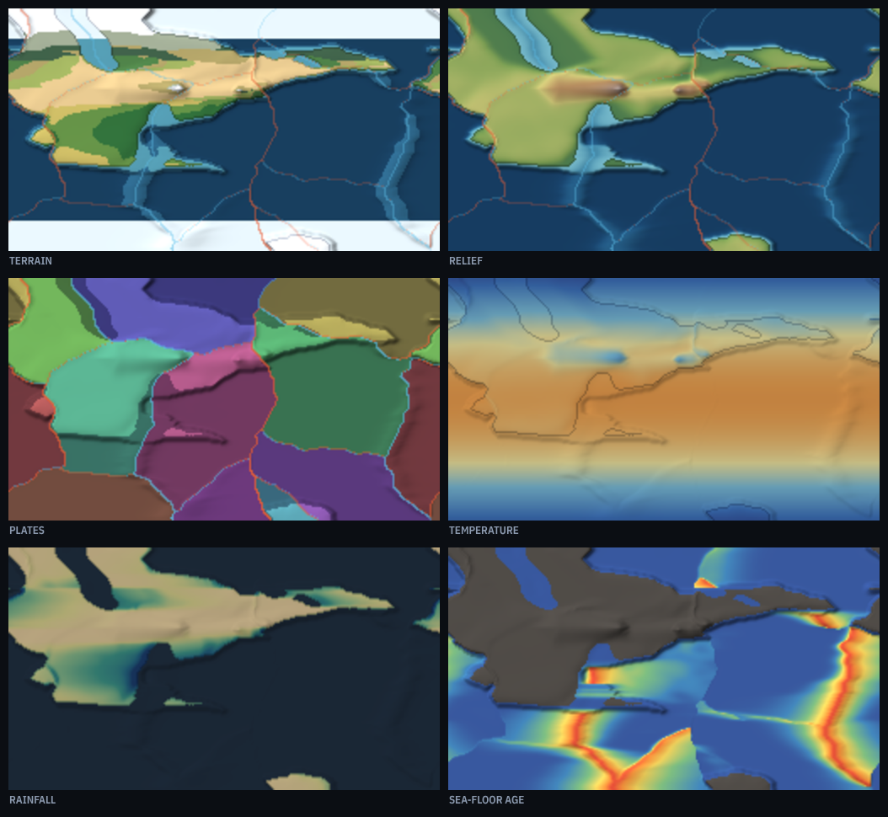

# Forming of Earth

A planet built out of nothing but a seed. Plates drift across a cylindrical
world, crash into each other and raise mountains, tear open and flood, while
rain and rivers wear the whole thing back down. Watch it from the first crust
to a billion years on, and read what happened in the chronicle beside the map.



## Running it

Open `index.html` in a browser. There is no build step, no package manager and
no dependencies — plain scripts and a canvas.

```sh
git clone <this repo> && cd forming_of_earth
open index.html          # or: python3 -m http.server 8000
```

The seed goes in the URL, so `index.html#karst-472` always grows the same
planet.

## What it models

Each step is **2 million years**. Every process below runs once per step, in
this order, on a 256 × 144 grid that wraps east to west.

| Process | What it does |
| --- | --- |
| **Plate motion** | Plates are a warped Voronoi diagram over drifting centres, so their outlines are ragged rather than circular. Each carries a velocity that wanders slowly, at 1–5 cm a year. |
| **Boundary forces** | Where two plates meet, their relative motion decides the outcome. Both sides continental: the crust crumples into fold mountains. One oceanic: it dives, opening a trench and raising a volcanic arc behind it. Pulling apart: continental crust rifts and drops, oceanic crust spreads and sets at ridge height. |
| **Advection** | The height field is carried along with the plate that owns it, sampled with a clamped Catmull-Rom filter so coastlines stay sharp. |
| **Hotspots** | A handful of mantle plumes stay fixed while plates slide over them, leaving island chains behind. |
| **Thermal subsidence** | Ocean floor is born hot at a ridge and sinks as it cools, with the square root of its age. This is what carves the deep basins, and why the sea-floor age map and the depth map look so alike. |
| **Crustal balance** | Arcs and plumes keep converting sea floor to continent. Subduction erosion at the margins answers it, holding the continental share near where it started. |
| **Erosion** | Slopes steeper than the crust will hold slump; rivers cut hardest where the ground is high and steep, and drop their load in the first basin they reach. |
| **Sea level** | Water volume is conserved, so deepening basins drain the shelves and thickening crust floods them. A weak pull toward the chosen ocean coverage stands in for the rest of the water cycle (see *Liberties taken*). |
| **Climate** | Temperature from latitude and altitude. Moisture is marched downwind — easterlies at the tropics and poles, westerlies between — picking up over water and raining out over land, hardest where the ground climbs into the wind. Biomes follow from the two. |

### Where the numbers come from

The constants are not arbitrary. Heights are unitless internally and scale to
metres at 8 km per unit, chosen so the two kinds of crust land where Earth's
do: ocean floor about 4.5 km down, continental crust floating roughly 5 km
above it, with a steep slope between them. That gap is why the planet has a
shoreline at all. The temperature curve is fitted to Earth's mean annual
temperature by latitude; rainfall follows Earth's measured zonal profile, wet
at the equator and along the polar front, dry over the horse latitudes. Every
area, mean and volume is weighted by the cosine of latitude, since the grid is
equirectangular and a polar row covers far less ground than an equatorial one.

A world left running for a billion years settles near 30–35% dry land, ocean
basins averaging 4.5 km, a mean surface temperature around 15 °C and peaks of
4–5 km. Earth sits at 29%, 3.7 km, 15 °C — and 8.8 km at one point, though
averaged over a 156 km grid cell even Everest is about 5 km.

## The controls

**Starting conditions** apply to the next world: the seed, the number of
plates, and the ocean coverage (which also applies at once to the world on
screen).

**Forces at work** apply live. Plate drift, erosion and volcanism scale their
processes from nothing to 2.5×. Greenhouse shifts every temperature on the
planet; turn it down far enough and the oceans freeze from the poles in.

<kbd>Space</kbd> runs or pauses, <kbd>S</kbd> steps once, <kbd>N</kbd> rolls a
new world, <kbd>B</kbd> toggles plate edges, <kbd>1</kbd>–<kbd>6</kbd> switch
views.

## Liberties taken

- **The world is a cylinder, not a sphere.** The map wraps east to west and the
  poles are stretched, the way they are on any flat map. Plates slide off the
  top and bottom rather than meeting over a pole.
- **Sea level is nudged.** Conserving water volume alone, basins deepen over
  hundreds of millions of years and the oceans slowly retreat into them. A weak
  pull toward the chosen coverage holds the planet near the ocean fraction you
  asked for. Short-term floods and retreats still emerge on their own.
- **Continental area is held steady** by the crustal balance above. Real
  continental crust does grow over time, just much more slowly than this model
  would grow it unchecked.
- **Climate has no seasons, no ocean currents and no ice-albedo feedback.**
  Everything is an annual mean, so there is no Gulf Stream warming a coast and
  no runaway snowball.
- **Sea floor ages past anything Earth holds.** New crust at a ridge starts at
  zero and ages as it spreads, so the ridges are young and the basins old, as
  they should be. But a basin here is wide relative to how fast it spreads, so
  the oldest floor can reach 500 Ma where Earth recycles everything within
  about 180 Ma. Read the age map for its pattern, not its absolute numbers.
- **One cell is about 156 km across.** Nothing smaller than that exists here:
  no river valleys, no islands below the grid, no real mountain summits.

## Layout

```
index.html        page, styles, and the controls
src/rng.js        seeded PRNG, tileable gradient noise, name coining
src/world.js      plates, tectonics, erosion, sea level, the chronicle
src/climate.js    temperature, prevailing winds, rainfall, biomes
src/render.js     map views, relief shading, legends
src/main.js       the clock, the controls, the readouts
```

`src/world.js` and `src/climate.js` have no DOM dependencies, so they run under
Node for experiments:

```js
globalThis.FE = {};
require('./src/rng.js'); require('./src/world.js'); require('./src/climate.js');
const w = new FE.World({ seed: 'karst-472' });
for (let i = 0; i < 200; i++) w.step();
console.log(w.age + ' Ma', w.stats);
```
